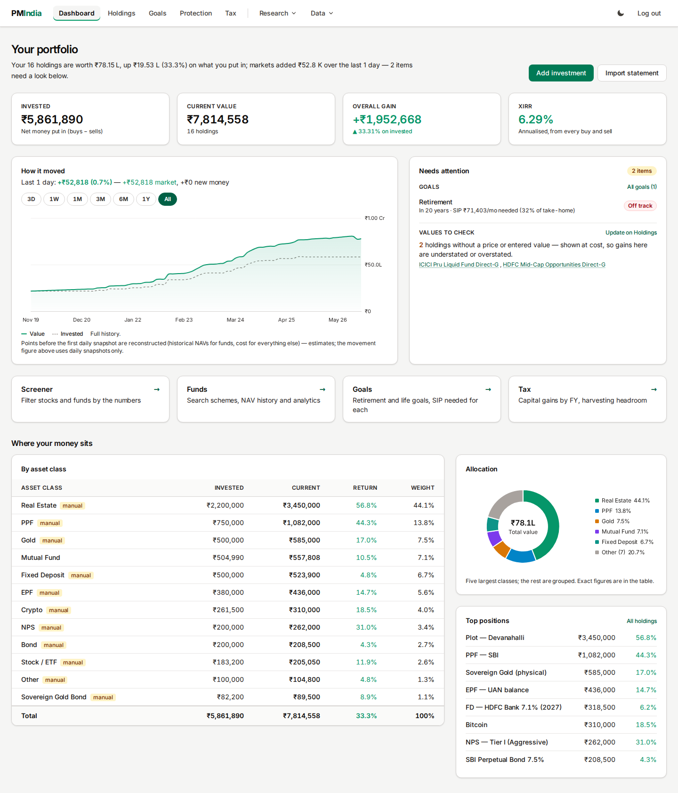
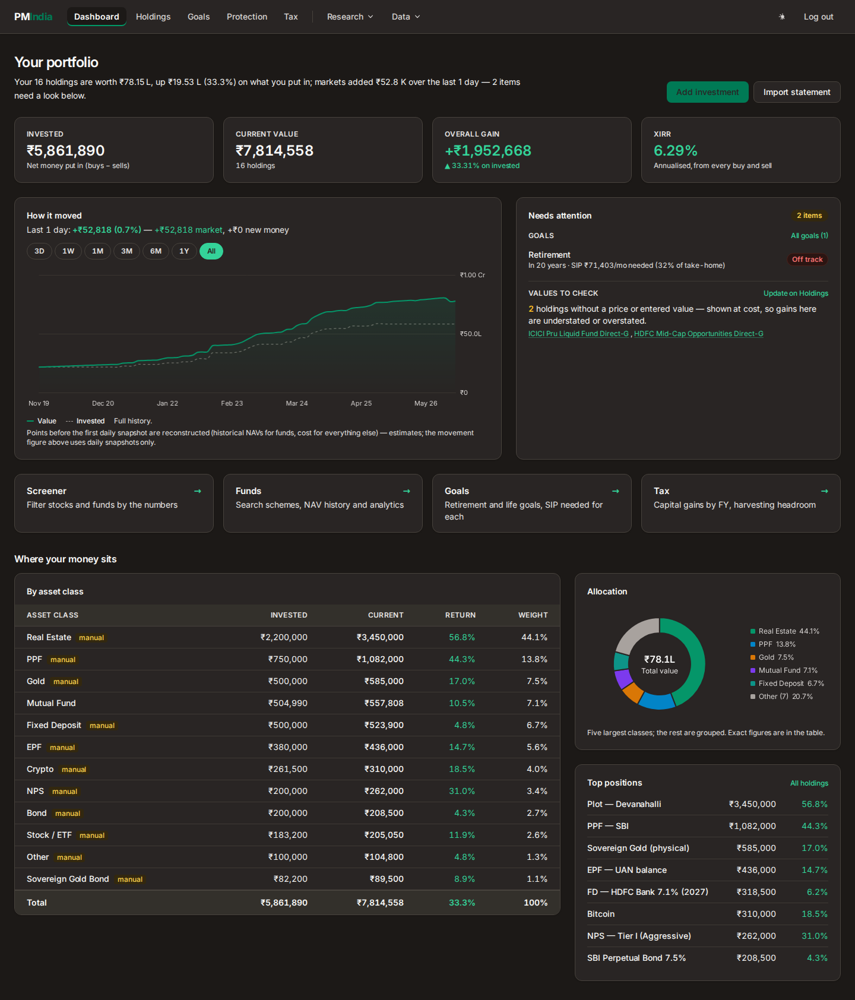
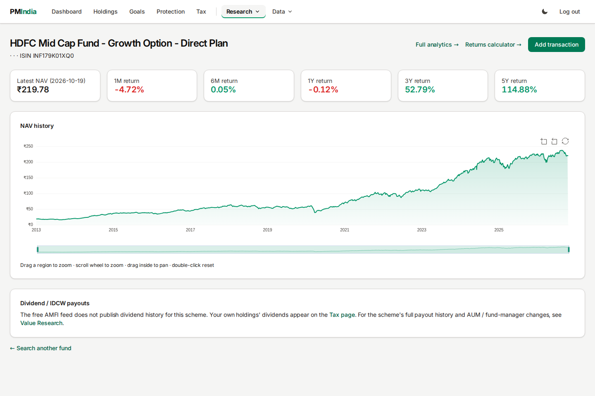
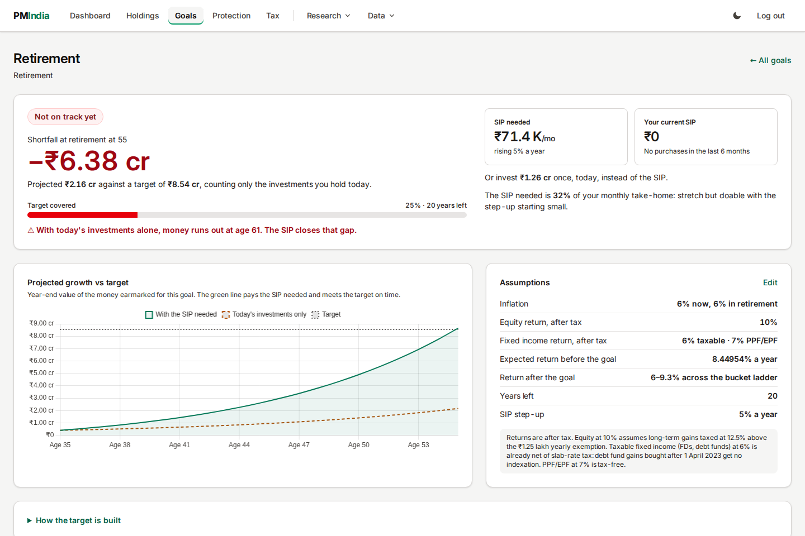
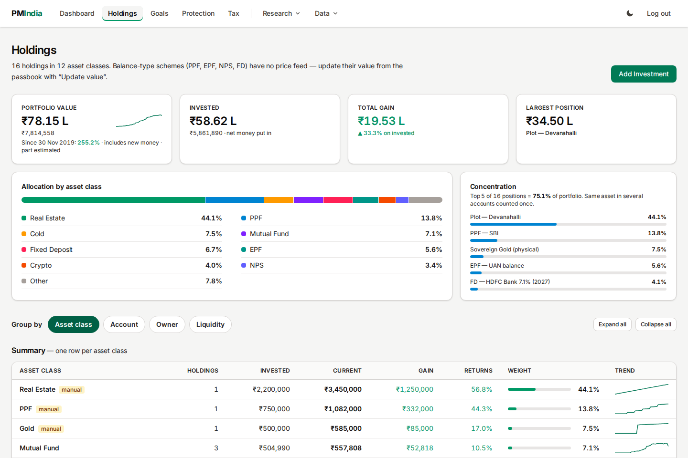
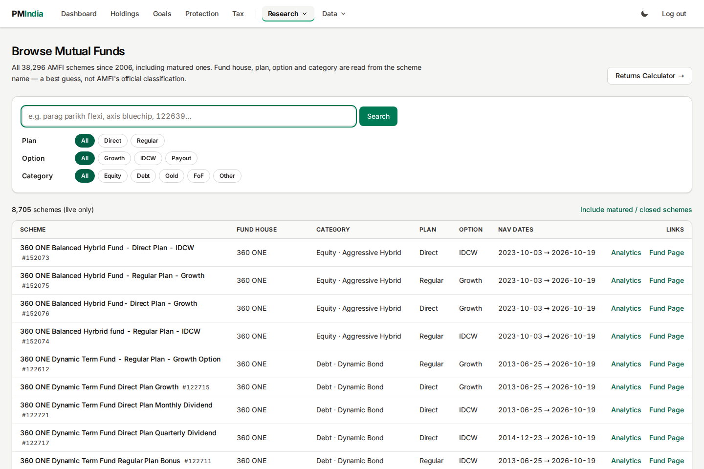

# PM India: a simple Indian portfolio tracker

A self hosted web app to track your Indian investments. It shows your net worth, helps with tax planning, plans your goals using the Freefincal robo advisor method, and gives you detailed fund analytics. Everything runs on your own machine.

## Screenshots

| | |
|---|---|
|  |  |

**Dashboard** — net worth trend, animated allocation donut, diversification and top positions. The trend chart reconstructs month-end history from real historical NAVs when daily snapshots are missing.

| | |
|---|---|
|  |  |

**Fund analytics** — zoomable NAV history (ECharts, line + gradient area, scroll/drag/double-click to zoom) with your buys overlaid, and the full risk metric suite. **Goal planner** — retirement drawdown with a 4-bucket ladder, SIP needed, and year-by-year projections.

| | |
|---|---|
|  |  |

**Holdings** — grouped by asset class with return weights. **Funds explorer** — all 38,000+ AMFI schemes with live search.


## Features

| Page | What it does |
|---|---|
| **Dashboard** | Portfolio value, allocation, diversification, and a trend chart |
| **Holdings** | Group by asset class, account, owner, or liquidity. Key numbers, an allocation bar, and collapsible sections |
| **Tax** | Realised and unrealised capital gains (FIFO, LTCG/STCG), a tracker for the Rs 1.25L exemption, 80C progress, a real estate sale what if (both tax regimes, Sec 54/54EC), and dividends/IDCW |
| **Funds explorer** | Browse and filter all 38,000+ AMFI schemes, including matured ones. Live search and fund details |
| **Fund analytics** | CAGR, volatility, Sharpe, Sortino, Omega, Calmar, skew, kurtosis, drawdowns, 50/200 DMA buy/sell/hold signals, Monte Carlo VaR and Expected Shortfall, and CAPM alpha/beta against NIFTY 500 TRI |
| **Returns calculator** | Lumpsum and SIP, shown in nominal and inflation adjusted terms |
| **Portfolio tools** | Upload a CSV or use your tracked funds to get MPT min variance and max Sharpe optimisation, an efficient frontier, CAPM verdicts, a fund overlap matrix, and a curated basket builder |
| **Goals** | A full port of the Freefincal robo advisor workbook. Retirement drawdown with a 4 bucket ladder, income streams with start and stop windows, annuity flooring, scenario analysis, year by year cash flow, and a simple path for people under 26 |
| **Protection** | Term, health, vehicle and other policies, annual premiums, renewal dates and a configurable term-cover adequacy check. Insurance stays outside investments |
| **Imports** | CAS statement, photo of any slip using OCR, or manual entry |

## Data sources

- **Live NAVs**: mfapi.in (per scheme, cached)
- **Full NAV history**: tigzig AMFI master Parquet (37.6 million rows, all schemes, April 2006 to today), queried directly with DuckDB:

  ```sh
  curl -L -o data/amfi_nav_master.parquet \
       https://api.tigzig.com/mf/v1/download/amfi_nav_master.parquet
  ```

- **Benchmark**: NIFTY 500 TRI via jugaad-data (fetched once, saved to `data/benchmark.csv`)

## Keeping the screener fresh

Run `.venv/bin/python manage.py build_screener --refresh` to download and validate
the latest tigzig AMFI NAV master, then rebuild `data/screener_metrics.parquet`.
Without `--refresh`, the command only reads the existing local master. Downloads
and builds replace their working files only after success. Allow disk space for
both the old and new master. The page's **Data as of** date is the newest NAV in
the source used for that build, not the file modification time. Older builds
without a recorded source date show "Data date unavailable" until rebuilt.

For a daily 07:00 refresh, add this to your user's crontab (replace the path;
cron uses the host's timezone, set the host to Asia/Kolkata for 07:00 IST):

```cron
0 7 * * * cd /absolute/path/to/pm-india && /usr/bin/flock -n data/screener.lock .venv/bin/python manage.py build_screener --refresh >> data/screener-refresh.log 2>&1
```

On first use, populate the base benchmark with
`.venv/bin/python manage.py shell -c 'from core.fund_analytics import load_benchmark; load_benchmark()'`.
That loader tops up the base NIFTY 500 TRI cache weekly. Other benchmark CSVs
and `data/debt_proxy.csv` are reused by the builder; `--refresh` refreshes the
NAV master only. To refresh those series, remove their cached files before a
rebuild. Check benchmark coverage before interpreting results: a recent NAV
source date does not imply every benchmark or computed window is current.
Do not run two builders concurrently. Daily source publication may lag a holiday.

## Run locally

```sh
python3 -m venv .venv && .venv/bin/pip install -r requirements.txt
sudo apt install tesseract-ocr          # only needed for the Scan feature
.venv/bin/python manage.py migrate
.venv/bin/python manage.py createsuperuser
.venv/bin/python manage.py runserver
```

## Run in Docker

```sh
docker compose build && docker compose up -d        # runs on :8010
```

## Tests

```sh
.venv/bin/python manage.py test core
```

This app is not SEBI registered and is for informational use only. Your financial data never leaves your machine. The SQLite database and the Parquet file are excluded from git.
